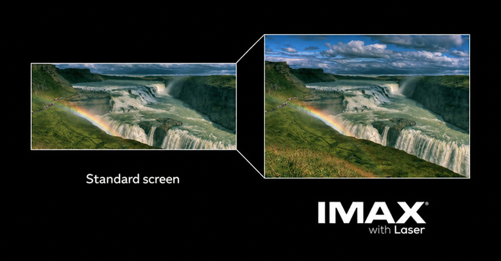
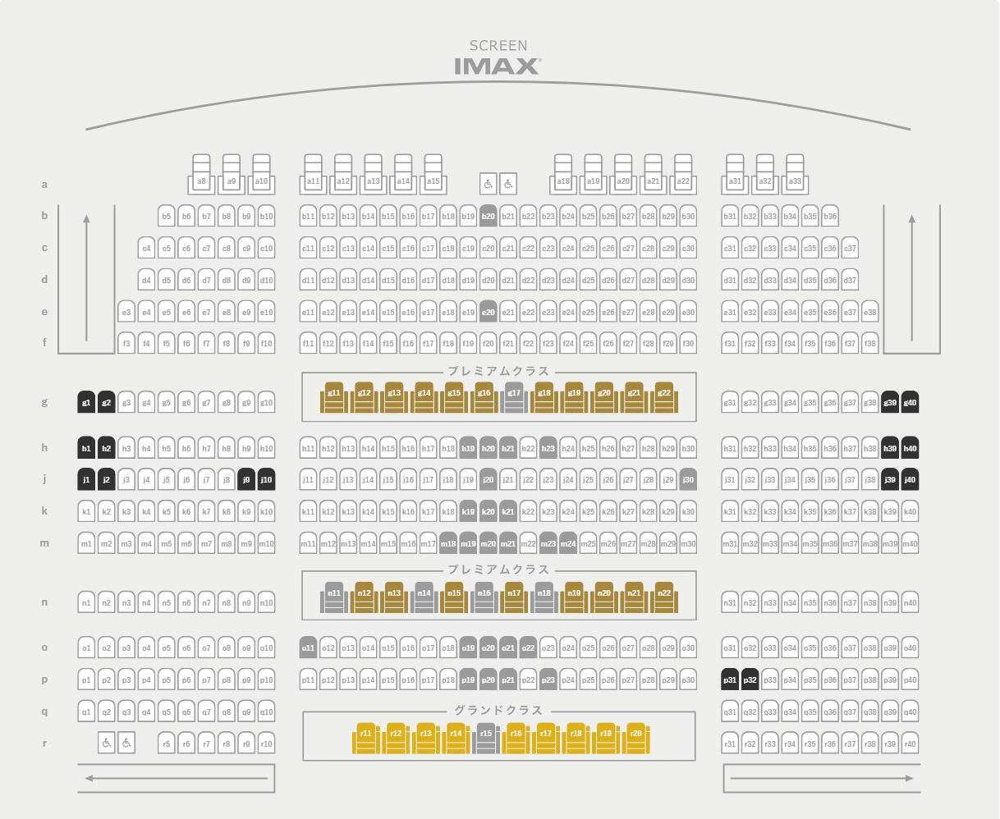

# Grand Cinema Sunshine Fastpass

## My watch log

- **Odyssey** — 2026/10/11 — **K-31**
- **Odyssey** — 2026/09/26 — **J-21**
- **Spider-Man: Brand New Day** — 2026/08/27 — **F-23**
- **Interstellar** — 2026/07/16 — **B-33**
- **Avatar: Fire and Ash** — 2025/12/31 — **H-21**

I only used this script for the latest Odyssey booking, K-31. I got in at **21:00:01** and picked the best seat still available. K-31 wasn't a good seat for me, but Platinum members had already had their earlier booking window. The script doesn't guarantee a good seat.

## How to use

1. Install [Tampermonkey](https://www.tampermonkey.net/). In Chrome's extension settings, enable **Allow User Scripts** for it.
2. Copy [this script](cinema-retry.user.js) into Tampermonkey → **Create a new script**, then save.
3. Open your screening's **member booking link**, which starts with `https://login.member.cinemasunshine.co.jp/auth?redirect_uri=...`. The script remembers it automatically.

If Cinema Sunshine sends you to `#/congestion`, the script immediately retries your original booking link. It checks for that route every 50 milliseconds. It leaves `#/purchase/seat` alone so you can choose seats and finish booking.

There is no Start button or timer to set. Open the correct booking link when your sale window begins. Disable the script in Tampermonkey to stop retries. Use one booking tab at a time: opening another screening's member link replaces the saved link. The saved link stays in Tampermonkey storage until replaced, so open the correct one each time. No booking link or member token is included in this repo.

## Booking times

The **¥500 yearly moviegoer's CLUB membership** gives early access:

- **Platinum:** 3 days before, **20:30 JST**. Up to 2 tickets in the earliest window.
- **Bronze / Gold:** 3 days before, **21:00 JST**.
- **Non-members:** 2 days before, **00:00 JST**.

For a Friday show, member booking starts Tuesday evening. General booking starts Wednesday at midnight.

Platinum requires 6 eligible visits in the previous 3 months. Gold requires 3–5. Ranks update on the 1st of each month. Special screenings may have different sale times. [Official membership rules](https://www.cinemasunshine.co.jp/pages/moviegoers-club/) · [Booking FAQ](https://www.cinemasunshine.co.jp/qa/)

## Why IMAX GT

Grand Cinema Sunshine uses digital laser projection, not 70mm film. For films with a full-height IMAX version, it can still show the same **1.43:1 aspect ratio** as IMAX 70mm. [About IMAX GT](https://www.cinemasunshine.co.jp/pages/gdcs)

**My pick for the most immersive experience: the centre of row H or J, around seats 20–21.** Sit farther back if you prefer seeing the whole screen with less looking up.

[Seat map reference](https://note.com/cinema_apple0520/n/n5c33d4e39519?hl=en). Check the live booking page for availability.
